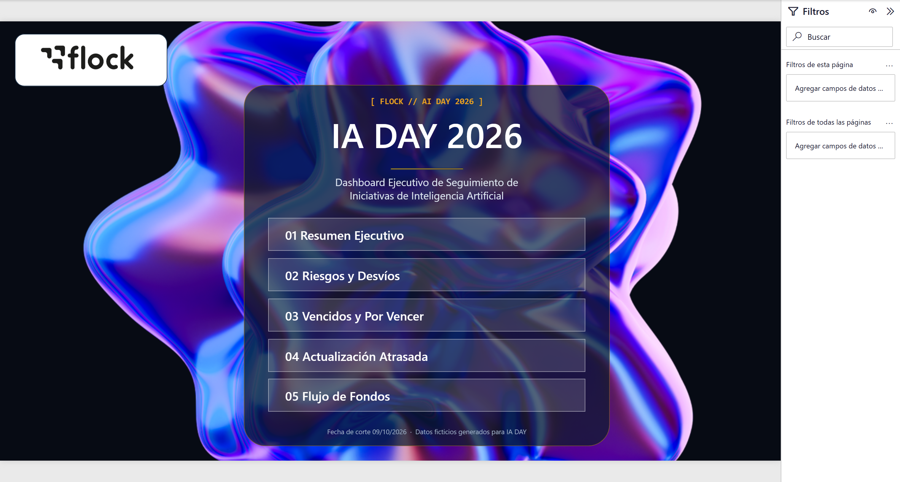
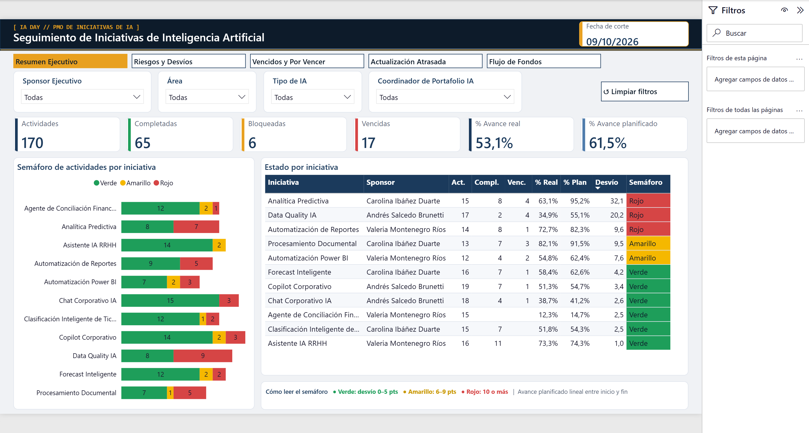
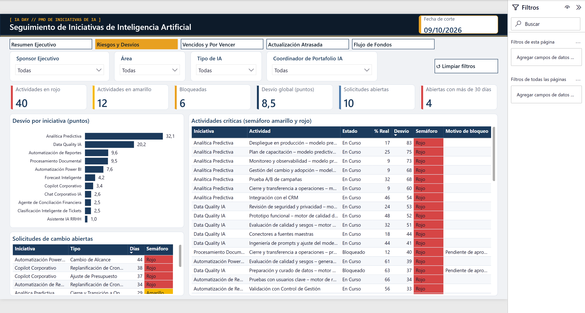
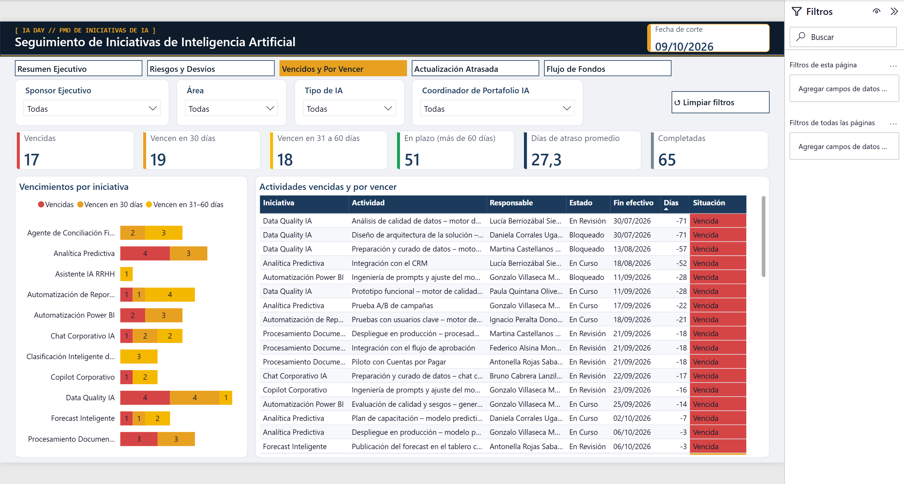
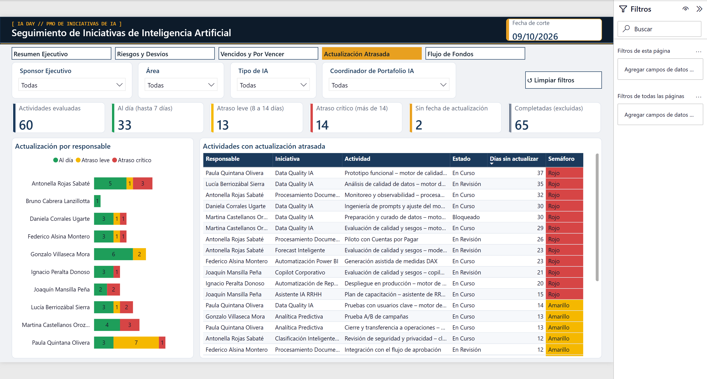
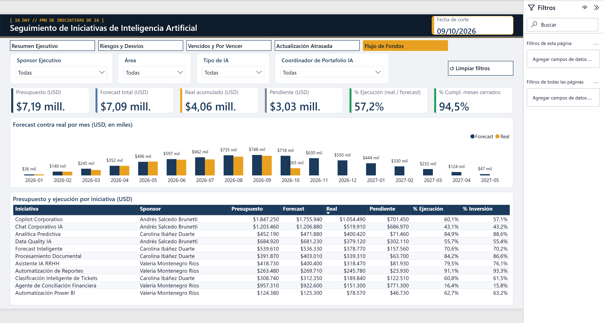
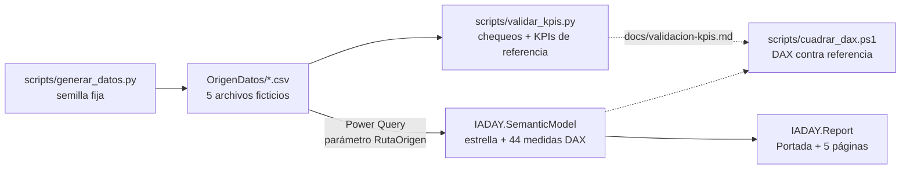
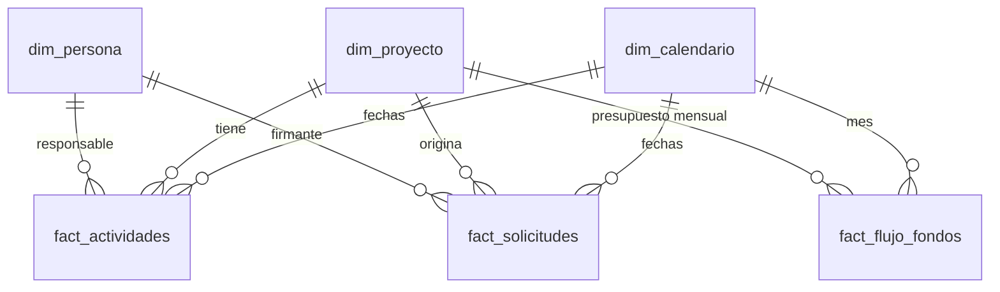

# IA DAY 2026 – Dashboard Ejecutivo de Seguimiento de Iniciativas de IA

Dashboard en **Power BI** (formato PBIP) que reemplaza los reportes manuales de seguimiento de una cartera de
iniciativas de Inteligencia Artificial por una única fuente de verdad: reglas explícitas, cifras auditables y
resultados reproducibles. Desarrollado para **Flock AI Day 2026** con Claude Code.

> ⚠️ **Todos los datos son ficticios.** Iniciativas, personas, montos y fechas se generaron desde cero para este
> proyecto. No hay información real ni conexión a sistemas productivos.



## Resumen

| | |
|---|---|
| **Desafío** | Tablero de seguimiento de proyecto utilizando datos de prueba |
| **Alcance** | 11 iniciativas de IA · 170 actividades · 114 registros de flujo de fondos · 26 solicitudes de cambio |
| **Fecha de corte** | Fija: **09/10/2026** (todos los cálculos la usan, por eso los resultados no cambian) |
| **Moneda e idioma** | USD · español |
| **Reporte** | Portada de inicio + 5 páginas con filtros sincronizados y navegación |
| **Modelo** | Esquema en estrella: 8 tablas, 9 relaciones, 44 medidas DAX |
| **Calidad** | 47 chequeos automáticos de datos y KPIs (48 con la referencia visual local); las medidas DAX se cuadran contra un cálculo independiente (107/107) |

## Objetivo

Responder, en menos de 10 segundos y sin armado manual, las preguntas que hoy se contestan con planillas:

1. ¿Cuál es la salud global de la cartera de IA y qué iniciativas atender primero?
2. ¿Qué actividades están vencidas, bloqueadas o por vencer?
3. ¿Qué responsables no actualizaron su información?
4. ¿Cuánto se planificó invertir y cuánto se ejecutó?

## Páginas del reporte

| Página | Pregunta que responde |
|---|---|
| **Portada** | Punto de entrada con menú de navegación a las 5 páginas |
| **Resumen Ejecutivo** | Estado global: avance real vs. planificado, semáforo y detalle por iniciativa |
| **Riesgos y Desvíos** | Dónde está el desvío, qué actividades son críticas y qué solicitudes siguen abiertas |
| **Vencidos y Por Vencer** | Qué venció, qué vence en 30 días y qué vence entre 31 y 60 días |
| **Actualización Atrasada** | Qué tan fresca es la información de cada responsable |
| **Flujo de Fondos** | Forecast contra real por mes e iniciativa, ejecución y saldo pendiente |

Todas comparten cabecera con la fecha de corte, cuatro filtros sincronizados (Sponsor Ejecutivo, Área, Tipo de IA
y Coordinador de Portafolio IA) y el botón **Limpiar filtros**.

### Capturas

| Resumen Ejecutivo | Riesgos y Desvíos |
|---|---|
|  |  |
| **Vencidos y Por Vencer** | **Actualización Atrasada** |
|  |  |
| **Flujo de Fondos** | |
|  | |

## Arquitectura



- **Datos:** CSV generados por un script determinista, sin dependencias externas.
- **Modelo:** TMDL (texto) dentro de `IADAY.SemanticModel/`, apto para control de versiones.
- **Reporte:** formato PBIR (un JSON por página y visual) dentro de `IADAY.Report/`.
- **Control de calidad:** el validador recalcula los KPIs de forma independiente y `cuadrar_dax.ps1` los compara
  con las medidas DAX del modelo abierto.

## Modelo de datos



| Tabla | Tipo | Filas | Origen |
|---|---|---|---|
| `dim_proyecto` | Dimensión | 11 | CSV |
| `dim_persona` | Dimensión | 21 | CSV |
| `dim_calendario` | Dimensión | 730 | Power Query (2026–2027) |
| `fact_actividades` | Hechos | 170 | CSV |
| `fact_flujo_fondos` | Hechos | 114 | CSV |
| `fact_solicitudes` | Hechos (soporte) | 26 | CSV |
| `parametros` | Parámetro | 1 | Fecha de corte |
| `Medidas` | Contenedor | – | 44 medidas DAX |

Relaciones de muchos a uno, sin filtros bidireccionales. Detalle, reglas de coherencia de los datos y decisiones de
diseño en [`docs/modelo-datos.md`](docs/modelo-datos.md); campos de cada CSV en
[`docs/diccionario-datos.md`](docs/diccionario-datos.md).

## KPIs

Valores al corte del 09/10/2026 (referencia: [`docs/validacion-kpis.md`](docs/validacion-kpis.md)).

| KPI | Valor | Regla |
|---|---|---|
| Actividades totales / completadas / bloqueadas | 170 / 65 / 6 | R1 |
| % Avance real (promedio simple) | 53,08 % | R5 |
| % Avance planificado (lineal al corte) | 61,54 % | R2 |
| Desvío global | 8,46 pp | R3 |
| Semáforo de actividades (verde / amarillo / rojo) | 118 / 12 / 40 | R4: 0–5, 6–9, ≥ 10 pp |
| Vencidas | 17 (27,3 días de atraso promedio) | R6 |
| Por vencer en 30 / 31 a 60 días | 19 / 18 | R7 |
| Actualización atrasada (verde / amarillo / rojo) | 33 / 13 / 14 | R8: ≤ 7, 8–14, > 14 días |
| Semáforo de iniciativas (verde / amarillo / rojo) | 6 / 2 / 3 | R4 |
| Semáforo de firma de solicitudes | Verde ≤ 15, amarillo ≤ 30, rojo > 30 días | R11 |

Las reglas R1–R11, la fórmula DAX, las tablas usadas y los supuestos de cada medida están en
[`docs/kpis.md`](docs/kpis.md) y se cuadran contra el validador en [`docs/cuadre-dax.md`](docs/cuadre-dax.md).

## Metodología

El proyecto sigue **Explorar → Planificar → Programar → Confirmar**, con puertas de aprobación humana entre fases:

| Fase | Resultado |
|---|---|
| **Explorar** | Análisis de la referencia visual y de los requisitos del desafío |
| **Planificar** | Especificación, reglas de negocio, modelo de datos y preguntas abiertas resueltas antes de programar |
| **Programar** | Datos, modelo semántico, medidas DAX, páginas y portada, en cambios pequeños y verificables |
| **Confirmar** | QA visual con capturas, cuadre de DAX, validación de KPIs y preparación del repositorio |

Cada regla y cada decisión de diseño cita su origen en [`docs/trazabilidad.md`](docs/trazabilidad.md). La revisión
visual por página, con puntuaciones, está en [`docs/qa-visual.md`](docs/qa-visual.md).

## Skills utilizadas

El trabajo se organizó con el patrón **orquestador + especialistas**: siete skills de Claude Code en
[`.claude/skills/`](.claude/skills/), coordinadas por las instrucciones de [`CLAUDE.md`](CLAUDE.md).

| Skill | Rol |
|---|---|
| `ia-day-orchestrator` | Coordina el flujo, las puertas de aprobación y la consistencia entre piezas |
| `powerbi-architect` | Modelo semántico, relaciones, parámetros y páginas |
| `dax-expert` | Medidas y columnas calculadas |
| `data-generator` | CSV ficticios, reproducibles y coherentes |
| `html-to-powerbi-designer` | Traducción de una referencia visual a diseño de Power BI |
| `dashboard-reviewer` | Revisión de calidad desde una perspectiva ejecutiva |
| `github-documenter` | Documentación y preparación del repositorio |

## Cómo abrir el PBIP

**Requisitos:** Power BI Desktop reciente con soporte del formato PBIR (probado con la versión 2.157) y Windows.

1. Clonar el repositorio:
   ```bash
   git clone https://github.com/Fede-IADAY/IADAY.git
   ```
2. Apuntar el modelo a la carpeta de datos de su copia (el repositorio trae un valor neutro en el parámetro
   `RutaOrigen`). Desde PowerShell, en la carpeta del proyecto:
   ```powershell
   .\scripts\configurar_ruta.ps1
   ```
   Si PowerShell bloquea el script, ejecute `powershell -ExecutionPolicy Bypass -File .\scripts\configurar_ruta.ps1`.
   También puede hacerlo a mano: **Transformar datos → Administrar parámetros → `RutaOrigen`**, con la ruta completa
   de la carpeta `OrigenDatos`.
3. Abrir `IADAY.pbip` con Power BI Desktop y hacer clic en **Actualizar**. El reporte abre en la **Portada**.

> Si desea contribuir cambios, antes de cada commit restaure el valor neutro con
> `.\scripts\configurar_ruta.ps1 -Restaurar`, para no publicar rutas de su equipo.

## Cómo regenerar los datos

**Requisitos:** Python 3.9 o superior (solo biblioteca estándar).

```bash
python scripts/generar_datos.py     # regenera los CSV de OrigenDatos/ (semilla fija: mismo resultado siempre)
python scripts/validar_kpis.py      # chequeos y recálculo de KPIs; escribe docs/validacion-kpis.md
```

Los CSV regenerados son idénticos a los publicados. El validador hace 47 chequeos; el 48.º (que no se haya reutilizado ningún dato de la referencia visual) solo corre en la copia local del autor, que tiene `htlm/`; sin esa carpeta, `docs/validacion-kpis.md` se reescribe con 47 de 47. Después de regenerar, haga clic en **Actualizar** en Power BI Desktop. Para cuadrar las medidas DAX contra el
validador (con el modelo abierto; el puerto de Analysis Services figura en `msmdsrv.port.txt` del espacio de trabajo
de Desktop):

```powershell
.\scripts\cuadrar_dax.ps1 -Puerto <puerto> -Base <nombre-de-la-base>
```

## Estructura del repositorio

```
├─ CLAUDE.md                 Instrucciones fijas para Claude Code
├─ IADAY.pbip                Proyecto de Power BI
├─ IADAY.Report/             Reporte (PBIR): portada, 5 páginas, tema e imágenes
├─ IADAY.SemanticModel/      Modelo semántico (TMDL)
├─ OrigenDatos/              CSV ficticios (dim_proyecto, dim_persona, fact_actividades,
│                            fact_flujo_fondos, fact_solicitudes)
├─ scripts/                  generar_datos.py · validar_kpis.py · cuadrar_dax.ps1 · configurar_ruta.ps1
├─ docs/                     Especificación, modelo, KPIs, trazabilidad, validaciones y capturas
├─ fotos de portada/         Imágenes de origen de la portada (fondo y logotipo)
└─ .claude/skills/           7 skills del equipo (orquestador + especialistas)
```

## Documentación

| Documento | Contenido |
|---|---|
| [`docs/spec.md`](docs/spec.md) | Objetivo, alcance, reglas, páginas y criterios de aceptación |
| [`docs/modelo-datos.md`](docs/modelo-datos.md) | Esquema en estrella, relaciones y reglas de coherencia |
| [`docs/diccionario-datos.md`](docs/diccionario-datos.md) | Campos de cada CSV |
| [`docs/kpis.md`](docs/kpis.md) | KPIs y medidas DAX, con supuestos a confirmar |
| [`docs/trazabilidad.md`](docs/trazabilidad.md) | Reglas, diseño y decisiones con su origen |
| [`docs/validacion-kpis.md`](docs/validacion-kpis.md) | Chequeos y valores de referencia de los KPIs |
| [`docs/cuadre-dax.md`](docs/cuadre-dax.md) | Comparación de cada medida DAX con el valor de referencia |
| [`docs/qa-visual.md`](docs/qa-visual.md) | Revisión visual de las páginas, correcciones y puntuación |

## Qué se versiona

**Sí:** `IADAY.pbip`, el reporte y el modelo (PBIR y TMDL), `OrigenDatos/`, `scripts/`, `docs/`, `fotos de portada/`,
`.claude/skills/`, `CLAUDE.md`, `README.md` y `.gitignore`.

**No:** cachés y configuración local de Power BI (`cache.abf`, `localSettings.json`), temporales, secretos y
credenciales, y el material de referencia local (`htlm/`, `Charla_de_Presentacion/`, copia original `Skills/`).

## Seguridad

No hay claves, credenciales ni rutas personales en el repositorio. Si alguna vez se necesitan claves, van en
variables de entorno y nunca en el código; `.env` está excluido por `.gitignore`.

## Créditos y marcas

El logotipo de Flock y la imagen de la portada se incluyen únicamente para este proyecto de demostración y pertenecen
a sus titulares. Los datos, nombres de personas y montos son ficticios; cualquier parecido con la realidad es casual.
