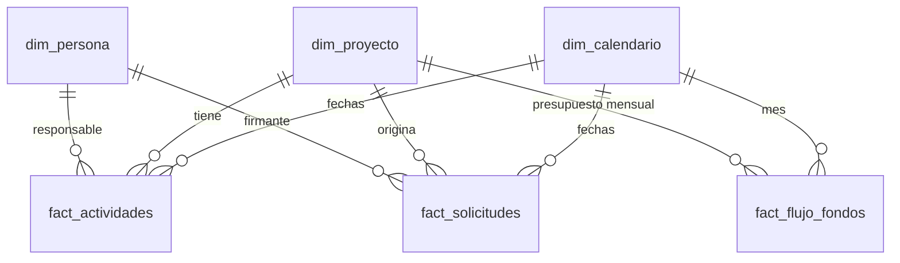

# Modelo de datos

## 1. Esquema en estrella



| Tabla | Tipo | Filas | Origen |
|---|---|---|---|
| `dim_proyecto` | Dimensión | 11 | `OrigenDatos/dim_proyecto.csv` |
| `dim_persona` | Dimensión | 21 | `OrigenDatos/dim_persona.csv` |
| `fact_actividades` | Hechos | 170 | `OrigenDatos/fact_actividades.csv` |
| `fact_flujo_fondos` | Hechos | 114 | `OrigenDatos/fact_flujo_fondos.csv` |
| `fact_solicitudes` | Hechos (soporte) | ver `docs/validacion-kpis.md` | `OrigenDatos/fact_solicitudes.csv` |
| `dim_calendario` | Dimensión | 730 | Se crea en el modelo con Power Query (M), no es CSV |
| `parametros` | Parámetro | 1 | Fecha de corte (09/10/2026) |
| `Medidas` | Contenedor | – | Medidas DAX (44) |

Los volúmenes exactos los confirma `docs/validacion-kpis.md` tras cada generación.

## 2. Relaciones

Implementadas en `IADAY.SemanticModel/definition/relationships.tmdl` (9 relaciones: 8 activas y 1 inactiva).

| Desde (N) | Hacia (1) | Columnas | Estado |
|---|---|---|---|
| `fact_actividades` | `dim_proyecto` | `id_proyecto` → `id_proyecto` | Activa |
| `fact_flujo_fondos` | `dim_proyecto` | `id_proyecto` → `id_proyecto` | Activa |
| `fact_solicitudes` | `dim_proyecto` | `id_proyecto` → `id_proyecto` | Activa |
| `fact_actividades` | `dim_persona` | `id_responsable` → `id_persona` | Activa |
| `fact_solicitudes` | `dim_persona` | `id_firmante` → `id_persona` | Activa |
| `fact_actividades` | `dim_calendario` | `fecha_fin` → `fecha` | Activa |
| `fact_actividades` | `dim_calendario` | `fecha_inicio` → `fecha` | **Inactiva** (se usa con `USERELATIONSHIP`) |
| `fact_flujo_fondos` | `dim_calendario` | `mes` → `fecha` | Activa |
| `fact_solicitudes` | `dim_calendario` | `fecha_creacion` → `fecha` | Activa |

Cardinalidad muchos a uno y dirección de filtro de dimensión a hecho. Sin relaciones bidireccionales.
La dependencia entre actividades (`id_predecesora`) es una columna descriptiva: no es una relación del modelo.

**Decisión de diseño — sponsor ejecutivo, líder y coordinador de portafolio IA:** `dim_proyecto` guarda
`id_sponsor`, `id_lider` e `id_coordinador_portafolio`. En lugar de tres relaciones adicionales con
`dim_persona` (que generarían rutas ambiguas hacia `fact_actividades`), el modelo expone sus nombres como
columnas calculadas de `dim_proyecto` (`Sponsor Ejecutivo`, `Líder de Iniciativa`,
`Coordinador de Portafolio IA`) mediante `LOOKUPVALUE`. `dim_persona` filtra solo al responsable de las
actividades y al firmante de las solicitudes.

## 3. Reglas de negocio y de coherencia de los datos
1. Estados válidos de actividad: Pendiente, En Curso, En Revisión, Completado, Bloqueado (R1).
2. Completado ⇒ `av_real` = 100 y con fecha de actualización. Solo Completado puede tener 100.
3. Pendiente ⇒ `av_real` = 0, `fecha_inicio` posterior al corte y sin fecha de actualización.
4. Bloqueado ⇔ tiene `motivo_bloqueo`.
5. Cada actividad cae dentro de la ventana de su iniciativa, incluso con `nueva_fecha_fin`.
6. `nueva_fecha_fin`, si existe, es posterior a `fecha_fin`.
7. `fecha_actualizacion` está entre el inicio de la actividad y la fecha de corte.
8. En `fact_flujo_fondos` hay un registro por iniciativa y mes; `real_usd` queda vacío solo para meses posteriores al corte.
9. El forecast total de cada iniciativa queda entre 93% y 107% de su presupuesto aprobado.
10. Toda iniciativa con actividades reprogramadas tiene una solicitud de "Replanificación de Cronograma".
11. **Dependencias lógicas** (cadena por iniciativa, `id_predecesora`):
    - Una actividad Completada exige que su predecesora esté Completada.
    - No se inicia una actividad cuya predecesora esté Pendiente.
    - Una actividad no puede tener más avance que su predecesora si esta no está Completada.
    - Las fechas de inicio y de fin no retroceden respecto de la predecesora.
12. **Equilibrio para la demo** (el generador busca de forma determinista la variante que lo cumple): al menos 7% de
    actividades en amarillo, entre 12% y 25% en rojo, al menos 4 iniciativas verdes, 2 amarillas y 2 rojas, al menos
    6% de actividades En Revisión, al menos 5 Bloqueadas y al menos una actividad iniciada sin fecha de actualización.
13. Los datos se generan con semilla fija; el avance planificado **no se guarda**: se calcula (R2).

## 4. Justificación de las decisiones
| Decisión | Motivo | Referencia conceptual en el HTML |
|---|---|---|
| Separar iniciativa y actividad | El desafío pide seguimiento a nivel de iniciativa y el generador define actividades | `PROJECTS` (proyecto) y desglose por gerente |
| `dim_persona` única | Sponsor, líder, responsable y coordinador comparten datos y se filtran igual | Agrupaciones por gerente, líder y responsable |
| `nueva_fecha_fin` en actividades | R6 define el fin efectivo con la mayor de dos fechas | `nueva_ffi` y `finEfectivo()` |
| `fecha_actualizacion` en actividades | R8 mide la frescura de la información | `fecha_actualizacion` y `semFecha()` |
| `id_predecesora` | Hace explícita y verificable la dependencia entre actividades | – (decisión de realismo del proyecto) |
| `fact_flujo_fondos` mensual | R9 pide forecast y real por mes | `FF_DATA` (forecast, real, pendiente) |
| `fact_solicitudes` | Da riqueza al modelo y respalda las reprogramaciones | `SOLICITUDES` |
| Avance planificado calculado | Depende de la fecha de corte; guardarlo duplicaría la regla | `av_estimado` (guardado en el origen; aquí se deriva) |
| Presupuesto aprobado en `dim_proyecto` | Referencia para medir ejecución | `inv_aprobada` |

Se reutiliza únicamente la **lógica conceptual**. Ningún dato, nombre, monto, ID ni fecha del HTML se copia
(`scripts/validar_kpis.py` lo comprueba automáticamente cuando `htlm/` está disponible).

## 5. Parámetros y tablas auxiliares (implementados)
| Elemento | Valor | Uso |
|---|---|---|
| Tabla `parametros`, columna `fecha_corte` | 09/10/2026 | Única "fecha de hoy" de todos los cálculos; la expone la medida `[Fecha Corte]` |
| Parámetro `RutaOrigen` | Carpeta de `OrigenDatos` | Todos los CSV se leen con `RutaOrigen & "\archivo.csv"`; se versiona con un valor neutro y cada usuario la ajusta con `scripts/configurar_ruta.ps1` o en Power Query |
| `dim_calendario` | 01/01/2026–31/12/2027 (730 días) | Tabla de fechas creada con Power Query (M): `fecha`, `anio`, `mes_numero`, `mes`, `anio_mes`, `trimestre`. Marcada como tabla de fechas. La fecha/hora automática está desactivada |
| Tabla `Medidas` | 44 medidas | Contenedor de medidas, organizadas en carpetas de visualización |

> `RutaOrigen` se publica con el valor neutro `C:\RUTA_LOCAL\IADAY\OrigenDatos`, sin rutas del autor. Hasta apuntarla a la carpeta `OrigenDatos` de cada equipo, el modelo abre pero no carga datos.

## 5b. Columnas calculadas
| Tabla | Columnas |
|---|---|
| `dim_proyecto` | `Sponsor Ejecutivo`, `Líder de Iniciativa`, `Coordinador de Portafolio IA` |
| `fact_actividades` | `Fin Efectivo`, `Avance Planificado`, `Desvío`, `Semáforo`, `Días sin Actualizar`, `Semáforo Actualización`, `Días para Fin Efectivo`, `Situación de Plazo` y columnas de color hexadecimal (`Color Semáforo`, `Color Semáforo Actualización`, `Color Situación de Plazo`) para el formato condicional |
| `fact_solicitudes` | `Días de Firma`, `Semáforo Firma`, `Color Semáforo Firma` |

Detalle y fórmulas en `docs/kpis.md`.

## 6. Regeneración
```
python scripts/generar_datos.py   # regenera los CSV (semilla base 20261009; busca la variante equilibrada)
python scripts/validar_kpis.py    # valida coherencia y recalcula KPIs
```
